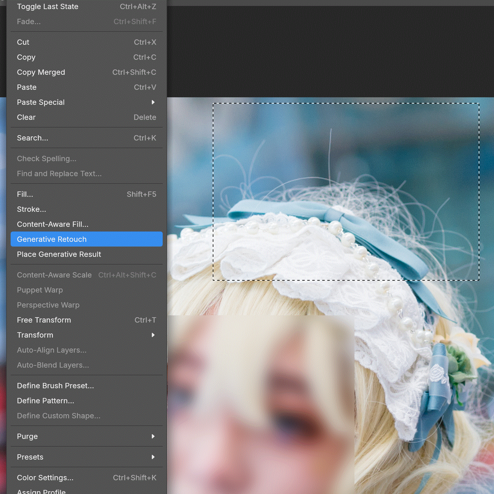
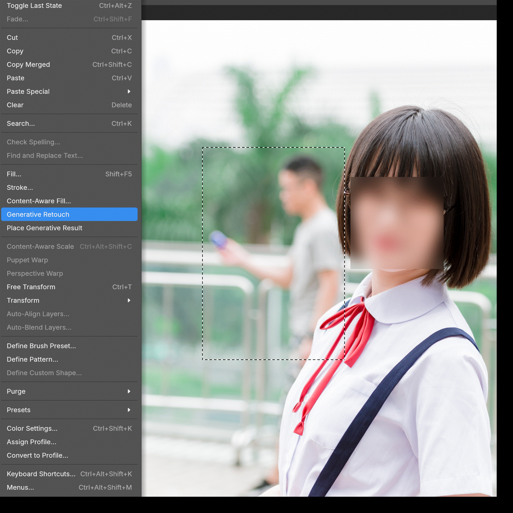

[繁體中文](README.md) · [English](README.en.md) · [日本語](README.ja.md)

# PhotoCraft × Nano Banana 2.1 retouch

Select a region on a picture and type an instruction. Gemini Nano Banana 2.1 generates an image and lays it over the original as a new layer. Several aspect ratios are supported, and you can generate again.

Remove stray hair:



Remove a passerby:



Each frame stays for 2 seconds. The stills for this sequence are `img/exp_e1.png` through `img/exp_e10.png`.

## Before you start

- Windows. On macOS, run it from source. See Q9.
- A Gemini API key

## Steps

1. Download `photocraft-gemini-windows-x64-portable.zip`, unzip it, and open `photocraft.exe`.
2. On the left, choose the Rectangular Marquee Tool, and lock the aspect ratio in the bar above the canvas.
3. Select the area you want to change.
4. Open **Edit**, then **Generative Retouch**.
5. The first click opens a command window. That window is the backend that talks to Gemini. Do not close it or stop it while an image is being generated.
6. Choose **Generative Retouch** again. A page opens. The first time, enter your Gemini API key and save it.
7. Type an instruction and start. Depending on the size of the selection, this can take several tens of seconds.
8. When it finishes, check the result. You can generate it again.
9. Back in PhotoCraft, open **Edit**, then **Place Generative Result**. The generated image is added as a layer.

## Questions

> Q1. Which aspect ratios work?

These ratios are supported. A shape closer to a square usually gives a better result.

1:1, 1:4, 1:8, 2:3, 3:2, 3:4, 4:1, 4:3, 4:5, 5:4, 8:1, 9:16, 16:9, 21:9

> Q2. Which models are supported?

Only Nano Banana 2.1. Other models, including OpenAI, are not supported.

> Q3. Will there be new features or more models?

This started as something for the author's own use, so no updates are scheduled. Requests are still welcome.

> Q4. Can I modify it, publish it, or sell it?

The author added no extra restrictions. Changes and publishing follow PhotoCraft's existing licenses (MIT, Apache-2.0).

> Q5. Does it collect data?

The author cannot speak for the original PhotoCraft code. The features added here do not collect any data.

> Q6. What about security?

If that worries you, review the code with other tools, or build the program yourself. You can also run this feature from source without building an installer. See Q9.

> Q7. Which languages are supported?

The screenshots and this guide are in three languages. The app itself supports many common interface languages.

> Q8. Do I need to give credit?

The author does not require a special credit. Credit, and telling other people about it, are both welcome.

> Q9. How do I run it from source?

1. Install Rust. In the project root, copy `.env.example` to `.env` and set `GEMINI_API_KEY`.
2. Open two terminals. Start the backend and leave that window open, then start PhotoCraft:

```sh
cargo run -p photocraft-gemini-retouch -- --lang en
cargo run -p photocraft
```
