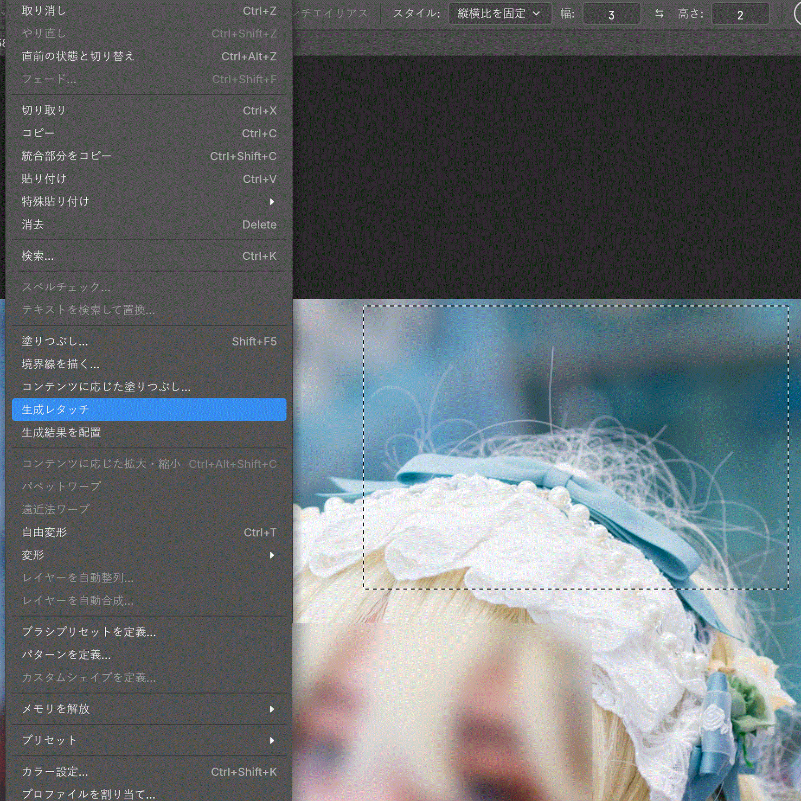
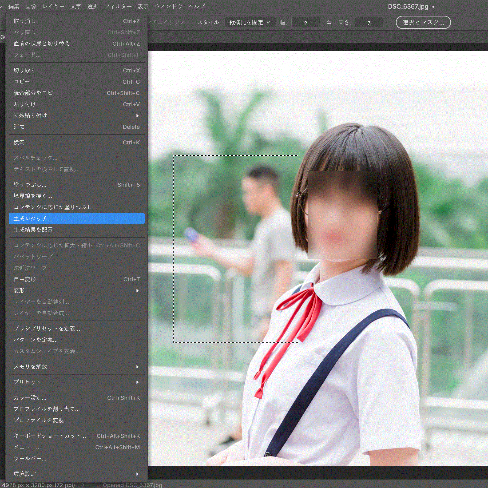

[繁體中文](README.md) · [English](README.en.md) · [日本語](README.ja.md)

# PhotoCraft × Nano Banana 2.1 自動レタッチ

画像の範囲を選んで指示を入力すると、Gemini Nano Banana 2.1 が画像を生成し、元の画像の上にレイヤーとして重ねます。複数の縦横比と、やり直しに対応しています。

ほつれ毛を消す：



通行人を消す：



各フレームは 2 秒です。静止画は `img/exp_j1.png` から `img/exp_j10.png` です。

## 準備

- Windows（macOS ではソースから実行します。よくある質問の Q9 を参照）
- Gemini API キー

## 手順

1. `photocraft-gemini-windows-x64-portable.zip` をダウンロードして展開し、`photocraft.exe` を開く
2. 左側で「長方形選択ツール」を選び、上のバーで縦横比を固定する
3. 変更したい範囲を選択する
4. 上の「編集」から「生成レタッチ」を選ぶ
5. 最初のクリックでコマンドウィンドウが開く。これは Gemini と通信するバックエンドなので、生成中は閉じたり止めたりしない
6. もう一度「生成レタッチ」を選ぶとページが開く。初めて使うときは Gemini API キーを入力して保存する
7. 指示を入力して生成を開始する。選択範囲の大きさによって数十秒かかることがある
8. 生成後に結果を確認し、必要ならもう一度生成できる
9. PhotoCraft に戻り、上の「編集」から「生成結果を配置」を選ぶと、生成したレイヤーが貼り付けられる

## よくある質問

> Q1. 対応する縦横比

次の縦横比に対応しています。正方形に近いほど、生成の質は高くなりやすいです。

1:1, 1:4, 1:8, 2:3, 3:2, 3:4, 4:1, 4:3, 4:5, 5:4, 8:1, 9:16, 16:9, 21:9

> Q2. 対応するモデル

現在は Nano Banana 2.1 のみです。他のモデルと OpenAI には対応していません。

> Q3. 新しい機能や、ほかのモデルへの対応はありますか

もともとは作者自身が使うために作ったもので、更新の予定はありません。要望があれば検討します。

> Q4. 改造、公開、営利はできますか

作者は追加の制限を付けていません。変更や公開は、PhotoCraft 本来のライセンス（MIT、Apache-2.0）に従ってください。

> Q5. データは収集されますか

PhotoCraft 本来の部分については作者には保証できません。作者が追加した機能は、データを収集しません。

> Q6. 安全性が心配な場合は

心配な場合は、ほかのツールでコードを確認するか、自分でビルドしてください。インストーラを作らず、ソースから実行することもできます。Q9 を参照してください。

> Q7. 言語

スクリーンショットとこの説明は 3 言語です。アプリの画面は、よく使われる多くの言語に対応しています。

> Q8. クレジットは必要ですか

作者は特別な表記を求めていません。表記や、ほかの人への紹介は歓迎します。

> Q9. ソースから実行する方法

1. Rust をインストールします。プロジェクトのルートで `.env.example` を `.env` にコピーし、`GEMINI_API_KEY` を記入します。
2. ターミナルを 2 つ開きます。先にバックエンドを起動してウィンドウを開いたままにし、そのあと PhotoCraft を起動します。

```sh
cargo run -p photocraft-gemini-retouch -- --lang ja
cargo run -p photocraft
```
