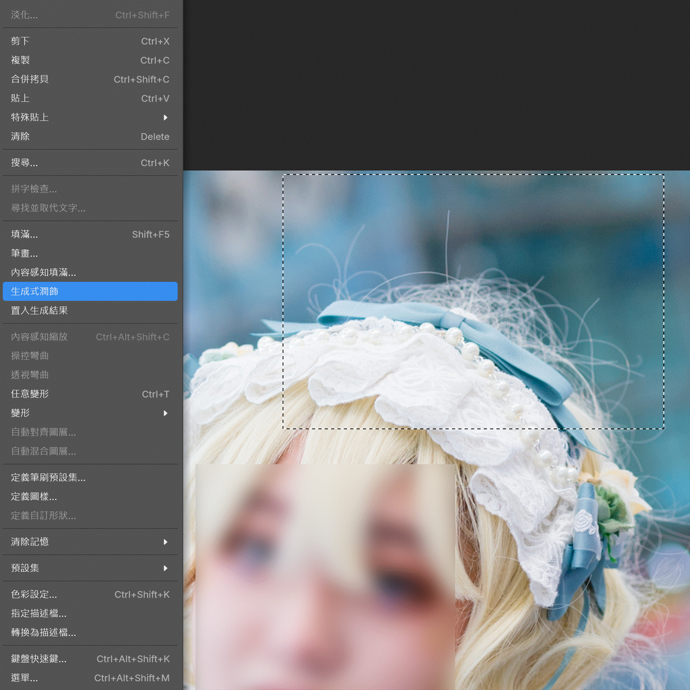
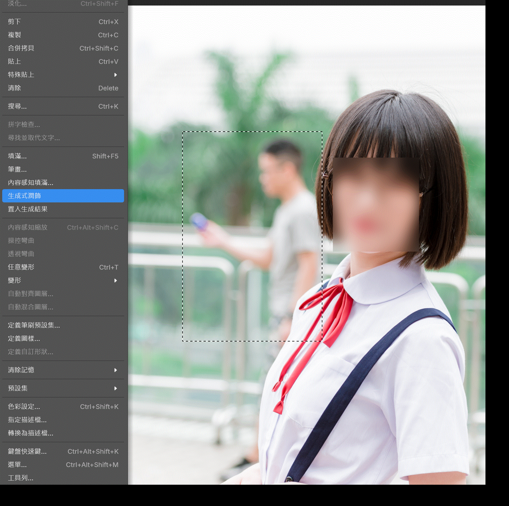

[繁體中文](README.md) · [English](README.en.md) · [日本語](README.ja.md)

# PhotoCraft x Nano Banana 2.1 自動修圖

在圖片上選取範圍後輸入指令，Gemini Nano Banana 2.1 模型會生成一張圖片並以圖層形式覆蓋在原圖上面，支援多種比例和重新生成。

去除多餘的頭髮：



去除路人：



每一格停留 2 秒。同一組靜態畫面在 `img/exp_t1.png` 到 `img/exp_t10.png`。

## 準備

- Windows 作業系統 (MacOS 需要從代碼直接運行，請參照常見問題 Q9)
- Gemini API 金鑰

## 步驟

1. 下載 `photocraft-gemini-windows-x64-portable.zip` 後解壓縮並點擊 `photocraft.exe`
2. 左面選擇「矩形選取畫面工具」，並在上面鎖定比例
3. 選擇需要修改的範圍
4. 點選上面「編輯」再點選「生成式潤飾」
5. 第一次點擊時會彈出一個命令終端，此為與 Gemini 溝通用的後端，生成過程中不能關掉或停下
6. 再點一次「生成式潤飾」會打開網頁，第一次使用時需要輸入 Gemini API 金鑰並儲存
7. 輸入指令並開始生成，視乎選取範圍大小可能需要數十秒
8. 生成完後可以檢查結果並選擇再次生成
9. 回到 PhotoCraft 點選上面「編輯」再點選「置入生成結果」即可貼上生成圖層

## 常見問題

> Q1. 支援比例
>
> 支援以下比例，但一般建議愈接近正方形愈高生成質素
>
> 1:1, 1:4, 1:8, 2:3, 3:2, 3:4, 4:1, 4:3, 4:5, 5:4, 8:1, 9:16, 16:9, 21:9

> Q2. 支援模型
>
> 現時只支援 Nano Banana 2.1 ，不支援其他模型也不支援 OpenAI

> Q3. 會否加入新功能、支援更多模型等等
>
> 專案本來只是打算作者自用，所以沒有預定任何的更新，但如果有需求也會考慮

> Q4. 可否再作改造、發佈、營利等等
>
> 作者沒有加上任何額外的限制，所有修改或發佈請參考 PhotoCraft 原有的特許條款 (MIT, Apache-2.0)

> Q5. 會否收集資料
>
> PhotoCraft 本來的部分作者不能保證，但作者加上的功能沒有收集任何資料

> Q6. 會否有安全性憂慮
>
> 如有任何安全性憂慮建議先用其他工具分析一次代碼或從代碼開始自己建置程式一次，本功能也支援在不用建置程式下直接從代碼執行，詳見 Q9

> Q7. 支援多種語言
>
> 截圖和說明雖然只有三種語言，但實際使用的界面支援各種常見語言

> Q8. 使用時是否需要標註
>
> 作者並不要求特別標註，但歡迎加上標註或幫忙擴散宣傳

> Q9. 如何從代碼直接執行
>
> 1. 需要已安裝 Rust，在專案根目錄把 `.env.example` 複製成 `.env`，填入 `GEMINI_API_KEY`
> 2. 打開兩個終端，先起動後端並保持視窗開著，再起動 PhotoCraft：

```sh
cargo run -p photocraft-gemini-retouch -- --lang zh-Hant
cargo run -p photocraft
```
